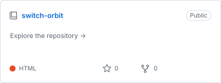
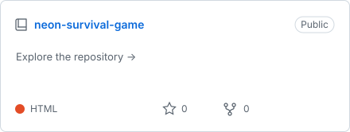
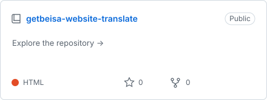
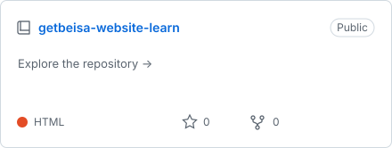
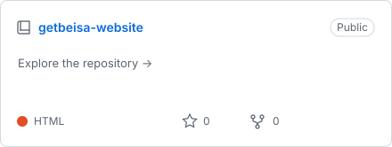
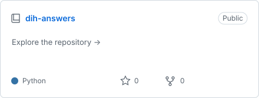

  

  
  &nbsp;
  

### Recent projects

<!-- RECENT-PROJECTS:START -->

  <a href="https://github.com/ibrahimelnemr/switch-orbit"><picture><source media="(prefers-color-scheme: dark)" srcset="assets/projects/switch-orbit-dark.svg" /></picture></a>
  <a href="https://github.com/ibrahimelnemr/neon-survival-game"><picture><source media="(prefers-color-scheme: dark)" srcset="assets/projects/neon-survival-game-dark.svg" /></picture></a>

  <a href="https://github.com/ibrahimelnemr/getbeisa-website-translate"><picture><source media="(prefers-color-scheme: dark)" srcset="assets/projects/getbeisa-website-translate-dark.svg" /></picture></a>
  <a href="https://github.com/ibrahimelnemr/getbeisa-website-learn"><picture><source media="(prefers-color-scheme: dark)" srcset="assets/projects/getbeisa-website-learn-dark.svg" /></picture></a>

  <a href="https://github.com/ibrahimelnemr/getbeisa-website"><picture><source media="(prefers-color-scheme: dark)" srcset="assets/projects/getbeisa-website-dark.svg" /></picture></a>
  <a href="https://github.com/ibrahimelnemr/dih-answers"><picture><source media="(prefers-color-scheme: dark)" srcset="assets/projects/dih-answers-dark.svg" /></picture></a>

<!-- RECENT-PROJECTS:END -->

[View all repositories →](https://github.com/ibrahimelnemr?tab=repositories)
