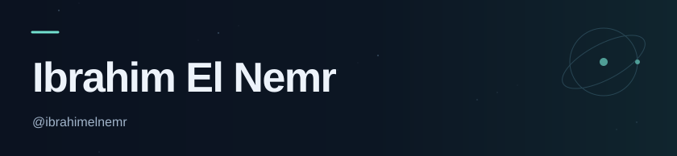
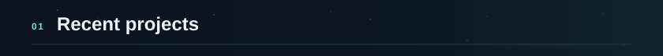
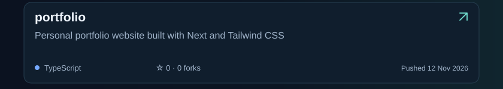
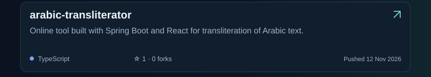
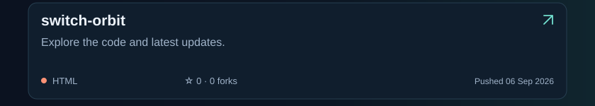
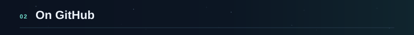
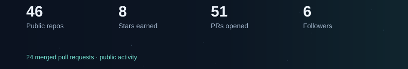
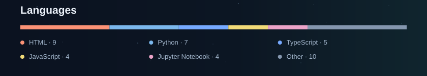

<!-- Generated by scripts/update_projects.py from public GitHub data. -->

<picture><source media="(max-width: 600px)" srcset="assets/header-mobile.svg" /></picture>
<a href="https://ibrahimelnemr.github.io/"><picture><source media="(max-width: 600px)" srcset="assets/portfolio-mobile.svg" /></picture></a><a href="https://www.linkedin.com/in/ibrahimelnemr/"><picture><source media="(max-width: 600px)" srcset="assets/linkedin-mobile.svg" /></picture></a>
<picture><source media="(max-width: 600px)" srcset="assets/projects-heading-mobile.svg" /></picture>
<a href="https://github.com/ibrahimelnemr/portfolio"><picture><source media="(max-width: 600px)" srcset="assets/projects/portfolio-mobile.svg" /></picture></a>
<a href="https://github.com/ibrahimelnemr/arabic-transliterator"><picture><source media="(max-width: 600px)" srcset="assets/projects/arabic-transliterator-mobile.svg" /></picture></a>
<a href="https://github.com/ibrahimelnemr/switch-orbit"><picture><source media="(max-width: 600px)" srcset="assets/projects/switch-orbit-mobile.svg" /></picture></a>
<picture><source media="(max-width: 600px)" srcset="assets/activity-heading-mobile.svg" /></picture>
<a href="https://github.com/pulls?q=is%3Apr+author%3Aibrahimelnemr+is%3Apublic"><picture><source media="(max-width: 600px)" srcset="assets/activity-mobile.svg" /></picture></a>
<a href="https://github.com/ibrahimelnemr?tab=repositories"><picture><source media="(max-width: 600px)" srcset="assets/languages-mobile.svg" /></picture></a>

